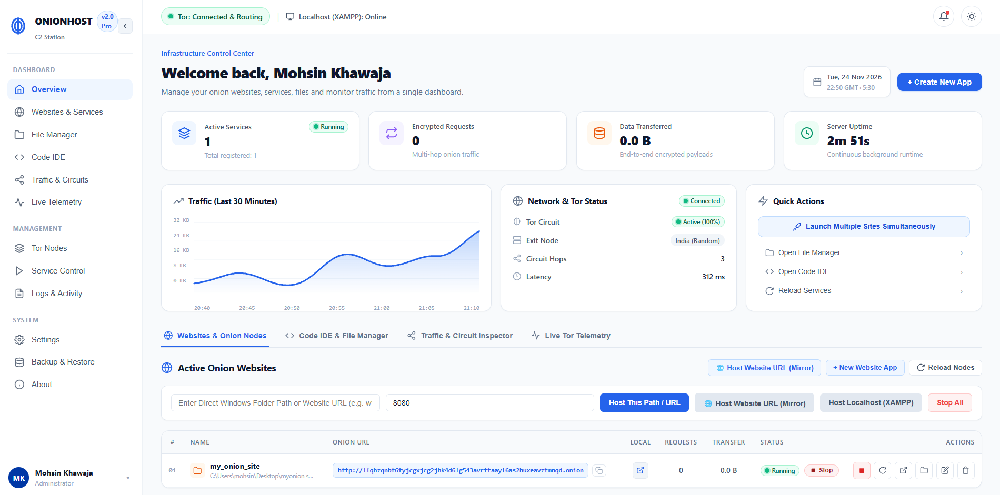

# OnionHost Local: Self-Hosted Tor Onion Web Server & Reverse Proxy Station

OnionHost Local is an open-source, self-hosted Tor hidden service orchestration engine and reverse proxy built for Windows. It enables developers, systems engineers, and privacy researchers to deploy local web applications, bind local development servers (Apache, XAMPP, Nginx, Node.js), or mirror public websites over Tor v3 (.onion) addresses without port forwarding, static public IPs, or paid cloud infrastructure.

<div align="center">
  
</div>

---

## Technical Overview & Capabilities

| Capability | Architecture / Mechanism | Target Scenarios | Security & Network Behavior |
| :--- | :--- | :--- | :--- |
| **Live Web Mirroring** | Reverse proxy with connection pooling | Public websites, corporate blogs, internal documentation | Decompresses gzip/deflate/br, strips hop-by-hop headers, rewrites URLs to relative paths |
| **Local Web Server Binding** | Localhost TCP loopback bridge | Apache, XAMPP, Nginx, Node.js, Flask, FastAPI | Binds existing local ports (e.g. 80, 8080) directly into Tor v3 hidden service descriptors |
| **Static Directory Scaffolding** | Built-in non-blocking HTTP daemon | Static HTML5, CSS3, JavaScript, WebAssembly bundles | Serves local directories with strict path-traversal prevention |
| **Multi-Site Orchestration** | Concurrent multi-service manager | Hosting multiple independent onion sites simultaneously | Unique persistent cryptographic keys, isolated local bindings, independent lifecycle |
| **Telemetry & Traffic Audit** | In-memory sliding window counters | Real-time traffic monitoring & Tor circuit state | Packet count, payload bytes, circuit hop count, latency measurements |
| **Management Interface** | Pure local Flask dashboard + CLI | Developer GUI or headless Windows execution | Dashboard strictly bound to 127.0.0.1; zero external Tor exposure |

---

## Hosting Modes Matrix

| Mode | Input Parameter | Local Binding | Tor Port | Encryption Protocol | Description |
| :--- | :--- | :--- | :--- | :--- | :--- |
| **URL Mirror** | `https://example.com` | `127.0.0.1:<allocated>` | Port 80 | Ed25519 Tor v3 | Reverse-proxies upstream web assets into an encrypted onion endpoint. |
| **Localhost Server** | Port number (`8080`) | `127.0.0.1:<port>` | Port 80 | Ed25519 Tor v3 | Exposes an active local web environment (XAMPP/Apache) without NAT configuration. |
| **Static Folder** | Directory path (`C:\...`) | `127.0.0.1:<allocated>` | Port 80 | Ed25519 Tor v3 | Automatically hosts folder contents through the internal HTTP engine. |

---

## Proxy & Tunneling Architecture

```text
[ Client (Tor Browser) ]
           │
           ▼ (End-to-End Encrypted Tor v3 Circuit)
[ Local Tor Daemon (tor.exe) ]
           │
           ▼ (127.0.0.1 Loopback Handshake)
[ OnionHost Local Core Engine ]
     ├── Mode A: Static Files Handler  ──> [ Local Folder Directory ]
     ├── Mode B: Local Proxy Bridge    ──> [ Local Server (Apache / XAMPP / Node) ]
     └── Mode C: Transparent Mirror    ──> [ Upstream Target Website (HTTP/HTTPS) ]
```

### Reverse Proxy Processing Pipeline
- **Decompression**: Automatically processes `gzip`, `deflate`, and Brotli (`br`) streams, normalizing payloads before passing to Tor Browser.
- **Header Sanitization**: Filters hop-by-hop and restrictive headers (`Content-Encoding`, `Content-Security-Policy`, `Strict-Transport-Security`, `X-Frame-Options`, `Transfer-Encoding`).
- **Dynamic Link Rewriter**: Intercepts absolute upstream URL references and normalizes them into relative `/` paths.
- **Resilient Connection Pool**: Employs HTTP keep-alive connection pooling with automatic HTTPS-to-HTTP fallback.

---

## System Requirements

| Component | Minimum Specification | Recommended | Notes |
| :--- | :--- | :--- | :--- |
| **Operating System** | Windows 10 (64-bit) | Windows 11 (64-bit) | Supports standard PowerShell and CMD |
| **Python Runtime** | Python 3.8 | Python 3.10+ | Standard CPython distribution |
| **Tor Executable** | Tor Browser 12.0+ or tor.exe | Bundled / Tor Browser | Auto-detected from Tor Browser or system PATH |
| **Memory (RAM)** | 512 MB | 2 GB | Lightweight RAM footprint (~40 MB per service) |
| **Network** | Outbound TCP (Internet) | Low-latency broadband | No inbound ports or router configuration required |

---

## Installation & Deployment

### 1. Clone the Repository
```bash
git clone https://github.com/csibmohsin/onionhost-local.git
cd onionhost-local
```

### 2. Run Automatic Installer
Execute the automated setup script in Command Prompt or PowerShell:
```cmd
install.bat
```
*Manual dependency installation via pip:*
```bash
pip install -r requirements.txt
```

### 3. Launch the Control Station
```cmd
start.bat
```
Navigate to the local dashboard in your browser:
```
http://127.0.0.1:5000
```
> **Security Guarantee**: The dashboard interface binds strictly to `127.0.0.1` and is never routed across the Tor network or exposed externally.

---

## CLI Command Reference

| Command Syntax | Arguments | Operational Function |
| :--- | :--- | :--- |
| `onionhost "<path>"` | Path to directory | Launches a static web folder as an onion service |
| `onionhost "<path>" --port 8080` | Directory path + port | Binds a specific local port for the static web server |
| `onionhost --dashboard` | None | Starts the local web control center on port 5000 |
| `onionhost --status` | None | Queries Tor daemon bootstrap, active circuits, and sites |
| `onionhost --list` | None | Outputs all registered services and their onion addresses |
| `onionhost --stop` | None | Gracefully terminates all active daemons and Tor processes |
| `onionhost --help` | None | Prints CLI flag manual and runtime options |

---

## Dashboard Architecture

| Viewport / Section | Functional Role | Monitored Metrics |
| :--- | :--- | :--- |
| **Overview Panel** | System-wide status & primary controls | Active services count, encrypted requests, total data transferred, uptime |
| **Traffic Telemetry** | Network throughput monitoring | Real-time SVG traffic chart (30-minute rolling window) |
| **Tor Circuit Inspector** | Overlay network diagnostics | Bootstrap percentage, circuit hop count, latency, exit relay origin |
| **Service Manager Table** | Individual site administration | Persistent .onion address, 1-click clipboard copy, icon binding, Start/Stop/Restart |
| **File Manager** | Remote folder browser | Directory traversal, file upload, file inspection, safe deletion |
| **Code IDE** | In-browser source editor | Syntax-highlighted HTML, CSS, JavaScript editing with hot reload |

---

## Repository Structure

```text
onionhost-local/
|-- config/                  # Configuration templates and dynamically generated torrc
|-- dashboard/               # Flask SaaS web dashboard backend, templates, and static assets
|   |-- static/              # CSS stylesheets and JavaScript reactivity modules
|   |-- templates/           # HTML dashboard interface
|   `-- app.py               # Localhost API endpoints and websocket handlers
|-- data/                    # Tor runtime state and cryptographic keys (git-ignored)
|-- logs/                    # Application and Tor bootstrap logs (git-ignored)
|-- sample_website/          # Built-in sample HTML scaffolding
|-- src/                     # Core backend engine
|   |-- config_manager.py    # Persistent settings and site registry
|   |-- onionhost_core.py    # Process orchestration and lifecycle manager
|   |-- security.py          # Input sanitization and path traversal defense
|   |-- server_manager.py    # Local HTTP server, proxy engine, and link rewriter
|   |-- tor_manager.py       # Tor binary detection and torrc generator
|   `-- website_manager.py   # File system browser and site scaffolding
|-- install.bat              # Automated Windows installer
|-- onionhost.py             # Standalone CLI interface
|-- requirements.txt         # Dependency declarations (Flask, requests)
|-- start.bat                # Dashboard launcher
`-- stop.bat                 # Process termination script
```

---

## Educational & Research Scope

This software is developed and published strictly for **academic research, security analysis, and privacy engineering exploration**. It provides developers, students, and network researchers with a reference architecture for:
- Analyzing privacy-preserving overlay networks and decentralized onion routing mechanisms.
- Studying reverse-proxy architectures under Tor v3 cryptographic protocols (Ed25519).
- Evaluating decentralized web hosting paradigms without centralized DNS registries or public IPv4 addresses.

Users are responsible for ensuring compliance with all applicable local, national, and international laws and regulations.

---

## Contributing

Contributions, enhancements, and technical feedback are welcome:
- To report a defect or propose an architectural enhancement, open an issue on GitHub.
- To submit code contributions, open a pull request detailing the proposed changes and verification tests.

---

## Author & Attribution

- **Developer**: Mohsin Khawaja ([@csibmohsin](https://github.com/csibmohsin))
- **Architecture**: Tor v3 Onion Routing & Reverse Proxy System

---

## License

This project is distributed under the MIT License.
